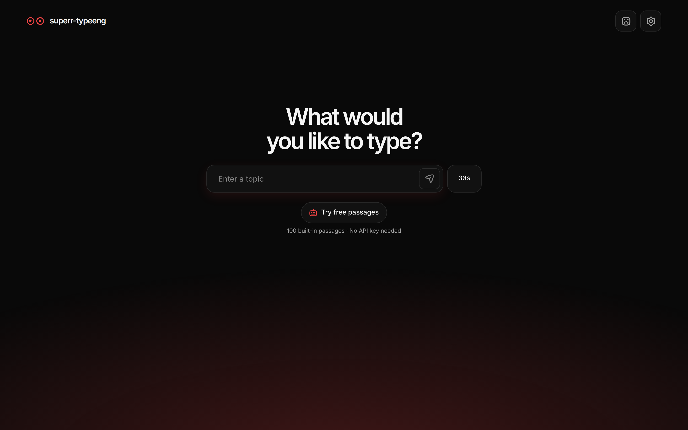
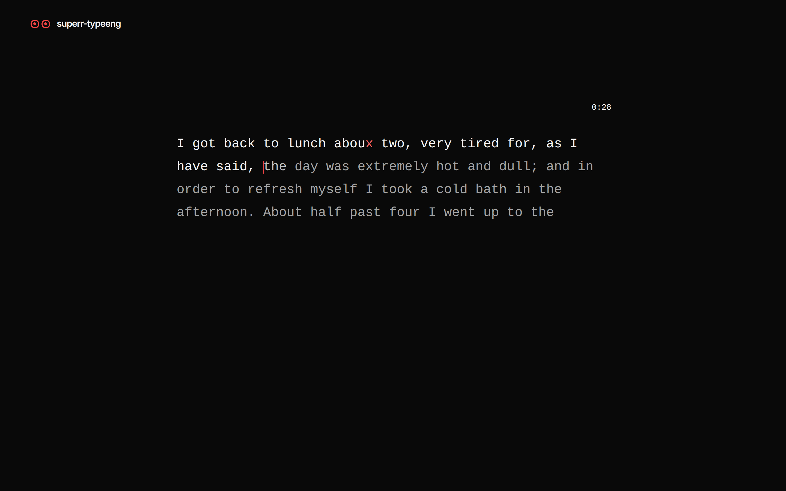
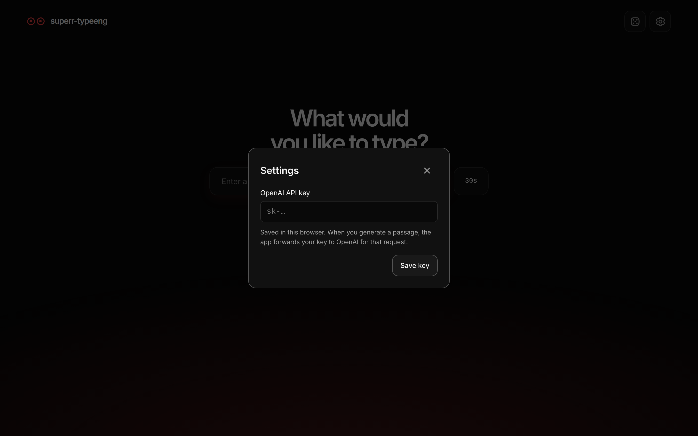
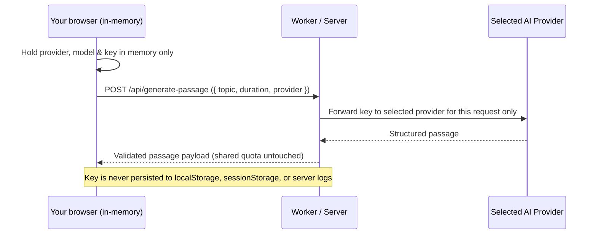

<div align="center">


<br>

**A minimal typing test that writes the passage for you.**<br>
Get 5 free AI generations every day with Cloudflare Workers AI (`@cf/google/gemma-4-26b-a4b-it`), browse 100 categorized free passages anytime, or connect your own API key across 10 AI providers.

<br>


[Features](#-features) · [Quick start](#-quick-start) · [Cloudflare Workers AI & Daily Quota](#-cloudflare-workers-ai--daily-quota) · [Your API key (10 Providers)](#-bring-your-own-key-10-providers) · [Scoring](#-how-scoring-works) · [Architecture](#-architecture)

</div>

<br>



## ✦ Three ways to practice

<table>
  <tr>
    <td width="33%" valign="top">
      <h3>✨ 5 free AI generations / day</h3>
      Enter any topic and get a fresh passage sized for your timer using <b>Google Gemma 4 26B A4B Instruct</b> on Cloudflare Workers AI. Every visitor gets <b>5 free AI generations per day</b> (resetting at midnight <code>Asia/Kolkata</code>). Failed requests and restarts never count against your quota.
    </td>
    <td width="33%" valign="top">
      <h3>📚 100 categorized free passages</h3>
      Open <b>Free passages</b> anytime to filter 100 curated passages across 5 categories (<i>Everyday &amp; Modern</i>, <i>Science Fiction</i>, <i>Mystery &amp; Adventure</i>, <i>Gothic &amp; Speculative</i>, and <i>Classic Fiction</i>) and 6 durations, or pick a <b>Random passage</b> with zero AI requests.
    </td>
    <td width="34%" valign="top">
      <h3>🔑 10-provider BYOK (in-memory)</h3>
      Connect your own API key in <b>Settings</b> for unlimited generations across <b>Google Gemini</b>, <b>OpenAI</b>, <b>Anthropic Claude</b>, <b>OpenRouter</b>, <b>Groq</b>, <b>Mistral AI</b>, <b>DeepSeek</b>, <b>Together AI</b>, <b>Fireworks AI</b>, or <b>Cloudflare Workers AI</b>. Keys stay in memory only for your current session.
    </td>
  </tr>
</table>

## ✦ Features

<table>
  <tr>
    <td width="50%" valign="top">
      <h3>🎯 Type about anything</h3>
      Enter a topic, pick a duration, and get a custom passage tailored to that timer. Stuck for ideas? Roll the 🎲 dice for a random topic.
    </td>
    <td width="50%" valign="top">
      <h3>⏱️ Six timers</h3>
      <code>30s</code> · <code>45s</code> · <code>60s</code> · <code>90s</code> · <code>120s</code> · <code>180s</code>. Passages are strictly bounded by word and character count for each duration.
    </td>
  </tr>
  <tr>
    <td valign="top">
      <h3>⌨️ Typing that feels right</h3>
      Space moves to the next word, Backspace can reopen a word with mistakes, paste is blocked, and IME composition and touch input both work. The passage always displays the expected text while highlighting your accuracy in place.
    </td>
    <td valign="top">
      <h3>♿ Accessible</h3>
      Fully usable from the keyboard with visible focus. Mistakes are shown with more than color, and animations respect reduced motion. Works from 320px phones to 4K screens.
    </td>
  </tr>
</table>

## ✦ A closer look

<table>
  <tr>
    <td width="50%"></td>
    <td width="50%"></td>
  </tr>
  <tr>
    <td align="center"><sub><b>Typing.</b> One smooth caret, mistakes in red, and the timer outside the text.</sub></td>
    <td align="center"><sub><b>Settings.</b> Connect any of 10 AI providers in memory for the current session.</sub></td>
  </tr>
</table>

## ✦ Quick start

> [!NOTE]
> Requires **Node.js 24** or newer.

```sh
npm ci
cp .env.example .env
cp .dev.vars.example .dev.vars
npm run dev
```

Open the local URL that Vite prints (usually `http://127.0.0.1:5173`). **Free passages** work right away offline. For AI passages, use one of these options:

| Option | How | Notes |
| --- | --- | --- |
| **Cloudflare Workers AI (Recommended)** | Authenticate with `npx wrangler login` and run `npm run dev:worker` (or deploy with `npm run deploy:worker`) | Uses `@cf/google/gemma-4-26b-a4b-it` via the `AI` binding with a 5/day shared quota per visitor (`DailyQuotaDurableObject`). |
| **Bring Your Own Key (10 providers)** | Open ⚙️ **Settings** next to the dice, select a provider and model, and save your API key | Held in memory only for the current browser tab session. Bypasses the shared 5/day quota. |
| **Server OpenAI fallback** | Set `OPENAI_API_KEY` in `.env` or `.dev.vars` | Used for shared generations when the Workers `AI` binding is unavailable. |

## ✦ Cloudflare Workers AI & Daily Quota

`superr-typeeng` integrates with **Cloudflare Workers AI** through `wrangler.jsonc` and `workers/ai/index.ts`, using **`@cf/google/gemma-4-26b-a4b-it`** (Google Gemma 4 26B A4B Instruct MoE) in **non-thinking mode** (`chat_template_kwargs: { enable_thinking: false }`) with strict JSON Schema output (`{"passage": "..."}`).

### Local Worker development

1. Authenticate Wrangler with your Cloudflare account (Workers AI always executes remotely on Cloudflare's GPU network):
   ```sh
   npx wrangler login
   ```
2. Start the Cloudflare Worker locally:
   ```sh
   npm run dev:worker
   # or: npx wrangler dev
   ```
3. You can either open the Worker URL directly (after running `npm run build`) or run Vite alongside it by setting `WORKER_DEV_URL=http://127.0.0.1:8787` in `.env` and running `npm run dev`.

### Deploying to Cloudflare Workers

Build the frontend and deploy the full-stack Worker + static assets in one step:

```sh
npm run build
npm run deploy:worker
```

### Daily 5-generation quota & free-tier cost controls (10,000 Neurons/day)

- **5 free AI generations per day (`Asia/Kolkata` midnight reset):** Enforced by `DailyQuotaDurableObject` (`QUOTA_DO`) and an HMAC-signed `superr_visitor` `HttpOnly` cookie (`server/quota.ts`). Quota slots are reserved before calling shared AI and released if generation fails or is canceled, so failed attempts never deduct from a visitor's 5 daily generations.
- **On-demand only:** `env.AI.run` is invoked only when a user explicitly submits a topic. Typing, restarting (`Restart`), and browsing or practicing **Free passages** consume **0 Neurons** and **0 daily quota**.
- **Non-thinking mode:** `chat_template_kwargs: { enable_thinking: false }` prevents internal reasoning tokens from consuming your token budget or adding latency.
- **Health & quota checks are free:** `GET /api/health` and `GET /api/quota` report Worker status, model readiness, and remaining daily quota without calling `env.AI.run`.
- **Rate & concurrency limits:** Protected by the `PASSAGE_RATE_LIMITER` binding (`wrangler.jsonc`), per-IP in-memory fallback, single-retry cap, and optional Cloudflare Turnstile verification (`TURNSTILE_SECRET_KEY`).

### Environment variables

| File | Variable | Purpose |
| --- | --- | --- |
| `.env` (`.env.example`) | `VITE_API_BASE_URL` | Optional public base URL for `/api/generate-passage` and `/api/quota` when frontend and Worker are hosted on separate origins |
| `.env` (`.env.example`) | `VITE_TURNSTILE_SITE_KEY` | Optional public Cloudflare Turnstile site key |
| `.env` (`.env.example`) | `WORKER_DEV_URL` | Optional Vite dev proxy target for `wrangler dev` (e.g. `http://127.0.0.1:8787`) |
| `.dev.vars` (`.dev.vars.example`) | `AI_MODEL` | Workers AI model ID (defaults to `@cf/google/gemma-4-26b-a4b-it`) |
| `.dev.vars` (`.dev.vars.example`) | `VISITOR_COOKIE_SECRET` | Secret key used to HMAC-sign the `superr_visitor` daily quota cookie |
| `.dev.vars` (`.dev.vars.example`) | `ALLOWED_ORIGINS` | Comma-separated list of allowed `Origin` headers for CORS and origin validation |
| `.dev.vars` (`.dev.vars.example`) | `TURNSTILE_SECRET_KEY` | Optional server-side Turnstile secret key verified before invoking AI |
| `.env` / `.dev.vars` | `OPENAI_API_KEY`, `OPENAI_MODEL` | Optional server-side OpenAI fallback credentials (`gpt-6-luna` default) when Workers AI is not bound |

## ✦ Bring your own key (10 providers)



- **10 supported providers:** Google Gemini, OpenAI, Anthropic Claude, OpenRouter, Groq, Mistral AI, DeepSeek, Together AI, Fireworks AI, and Cloudflare Workers AI (with Account ID).
- **In-memory session security:** Your API key is held **only in JavaScript memory** for the current browser tab (`src/personal-key-storage.ts`) and is never written to `localStorage`, `sessionStorage`, `IndexedDB`, cookies, or server logs. Reopening **Settings** displays only a masked prefix (e.g. `AIza••••`).
- **Direct quota bypass:** Requests made with your own API key use your selected provider and model directly without consuming the shared 5/day quota, and never silently fall back to shared server AI if your key is invalid or rate-limited.
- Click **Remove key** in Settings (or close/refresh the tab) to clear the key immediately and return to the shared daily quota.

## ✦ How scoring works

| Metric | What it means |
| --- | --- |
| **Net WPM** | Correct characters ÷ 5, divided by actual minutes elapsed |
| **Raw WPM** | All accepted keystrokes ÷ 5, divided by actual minutes elapsed |
| **Accuracy** | Share of accepted keystrokes that were correct |
| **Errors** | Wrong keystrokes plus skipped characters. Skipped characters don't count as keystrokes. |

The timer starts on your first keystroke. The test ends when time runs out or when you type the last character, whichever comes first. Fixing a mistake clears it from the screen, but it still counts in your error history. **Restart** gives you the same passage again without making another AI request.

## ✦ Architecture

```text
src/
├── App.tsx                  # Coordinates duration, quota, BYOK state, dialogs, and sessions
├── personal-key-storage.ts  # In-memory-only BYOK session storage and legacy Web Storage scrubber
├── typing/                  # Typing engine, native input, progressive passage rendering
├── ui/                      # Visual system, SettingsDialog, FreePassagesDialog, and controls
└── shared/                  # Duration limits, grapheme splitting, categorized sample catalog, BYOK specs
server/
├── passage.ts               # Request validation, shared AI + BYOK orchestration, retries, rate limits
├── providers.ts             # Multi-provider BYOK request builders and response extractors (10 providers)
├── quota.ts                 # 5/day Asia/Kolkata quota manager, signed visitor cookie, Durable Object
├── system-prompt.ts         # System prompt and user prompt builder for passage generation
└── node-adapter.ts          # Connects the API routes to Vite and the Node production server
workers/
└── ai/
    ├── index.ts             # Cloudflare Worker entrypoint (/api/generate-passage, /api/quota, /api/health)
    └── env.ts               # TypeScript definitions for AI, QUOTA_DO, and PASSAGE_RATE_LIMITER bindings
```

<details>
<summary><b>Design notes</b></summary>

<br>

- **Passage limits.** `src/shared/passage.ts` sets length limits for each timer, assuming a maximum speed of 20 characters per second (240 WPM). The 180-second passage is 3,600–4,000 characters long. The [Aalto typing study](https://userinterfaces.aalto.fi/136Mkeystrokes/) gives context for typical typing speeds.
- **Categorized sample catalog.** `src/shared/sample-catalog.ts` organizes 100 passages across 5 categories (`Everyday & Modern`, `Science Fiction`, `Mystery & Adventure`, `Gothic & Speculative`, and `Classic Fiction`), combining the original station vignette with 99 cleaned-up excerpts from public-domain books on [Project Gutenberg](https://www.gutenberg.org/ebooks/) (ebook IDs 11, 35, 36, 45, 84, 120, 174, 345, 514, 1260, 1342, 1400, 1661 and 2701).
- **Server safety.** The endpoint checks every request, limits the size of requests and responses, caps retries and request time, and limits how many requests and simultaneous generations each client can make. Topics and AI output are treated as untrusted and always shown as plain text.

</details>

## ✦ Checks and production

```sh
npm run lint
npm run typecheck
npm test
npx playwright install chromium
npm run test:e2e
npm run build
npm start
```

The Node production server (`npm start`) serves the built app and `POST /api/generate-passage` (plus `POST /api/passage`, `GET /api/quota`, and `GET /api/health`) from one origin, by default at `127.0.0.1:4173`. For serverless production with Cloudflare Workers AI, run `npm run build && npm run deploy:worker`.

<br>

<div align="center">
<sub>Built with focus. Black, red, and nothing extra. <b>⦿⦿</b></sub>
</div>
